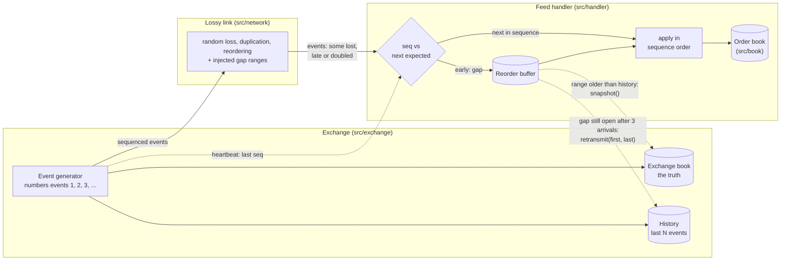
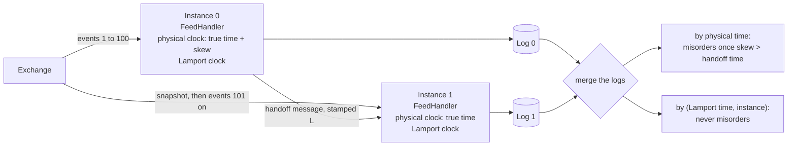
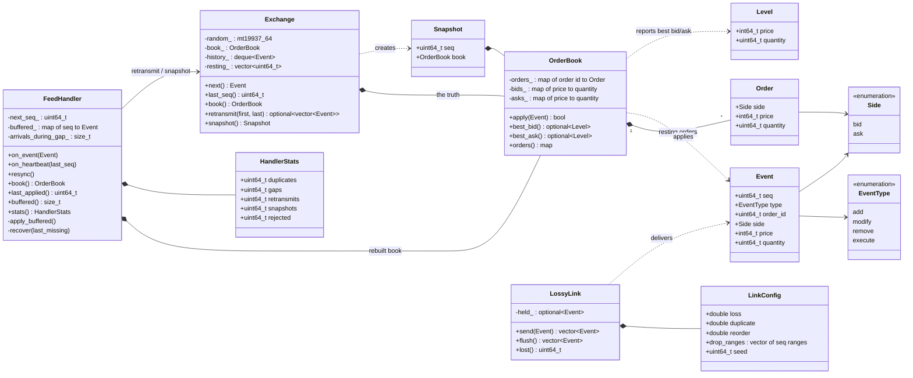
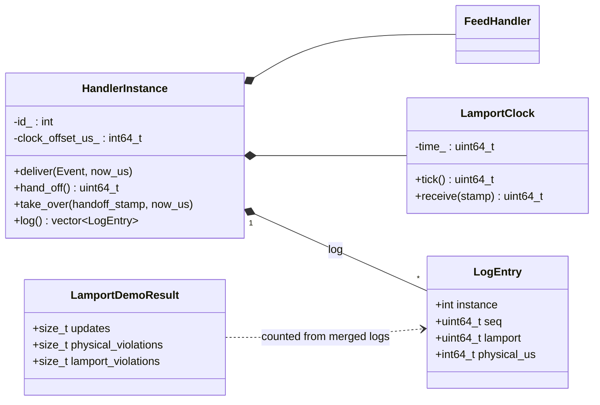
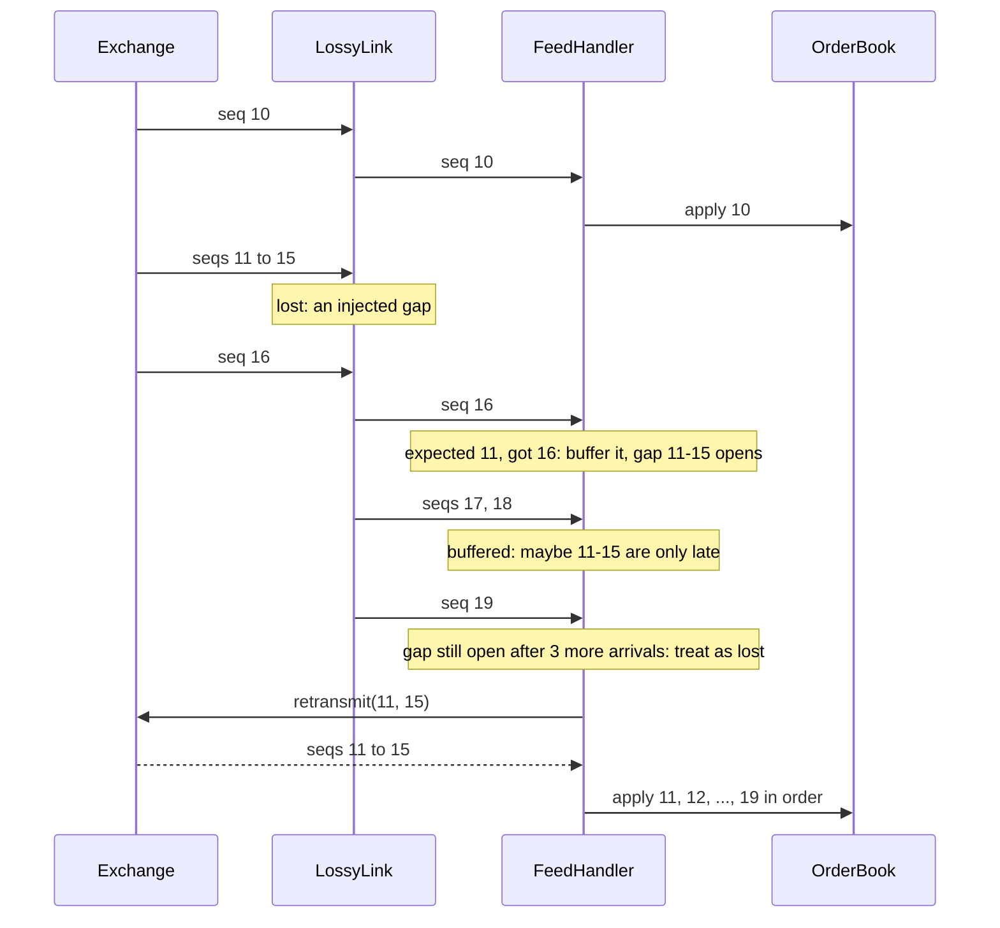
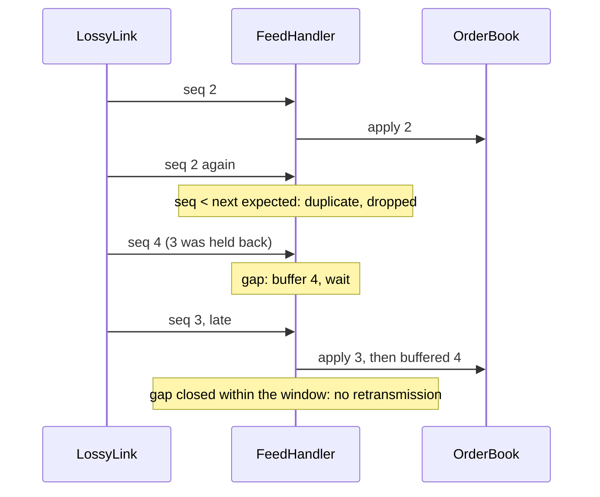
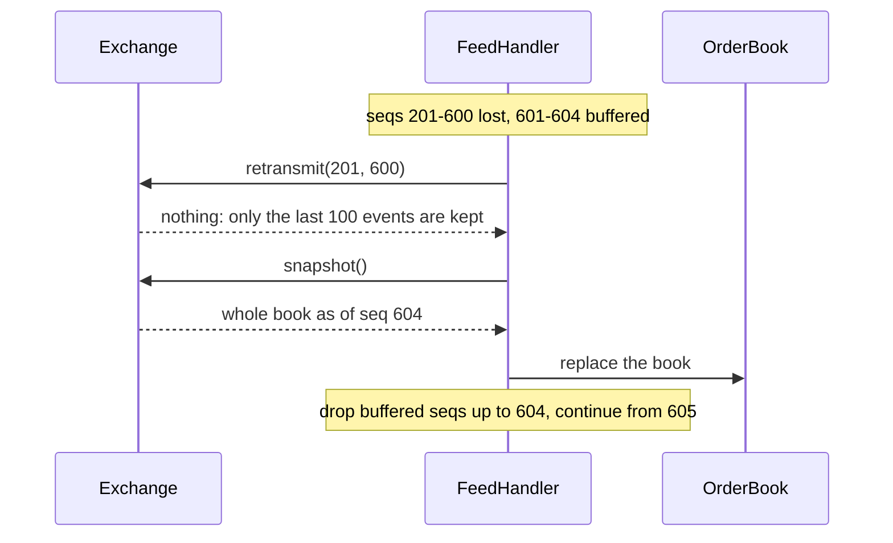
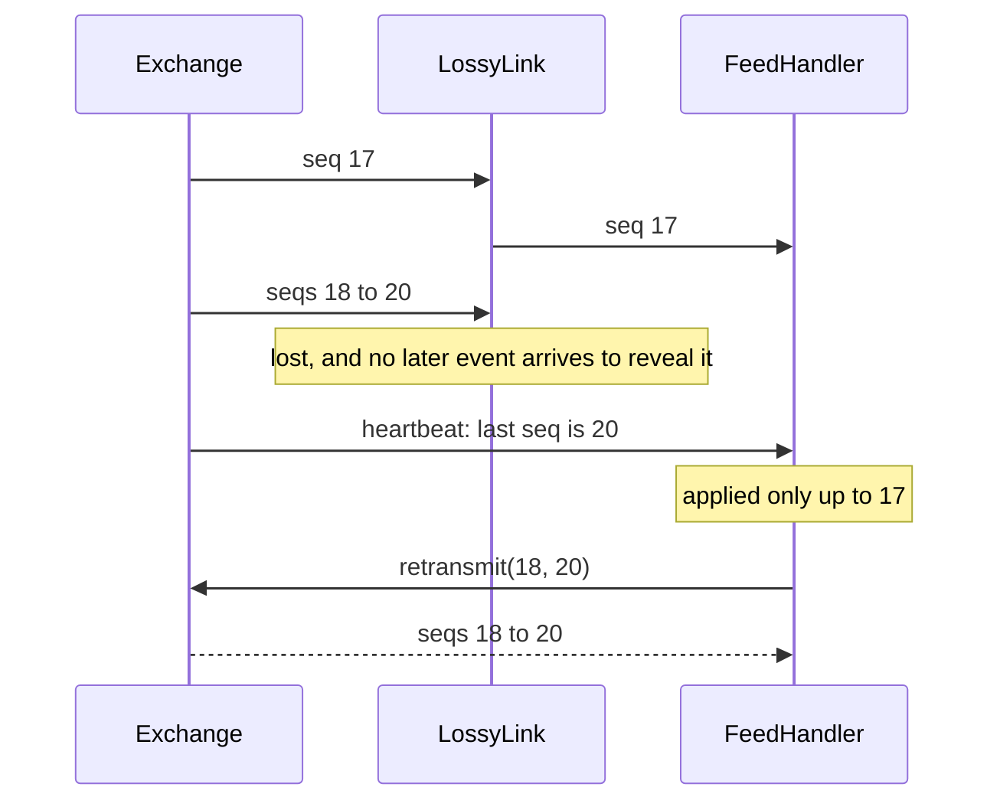
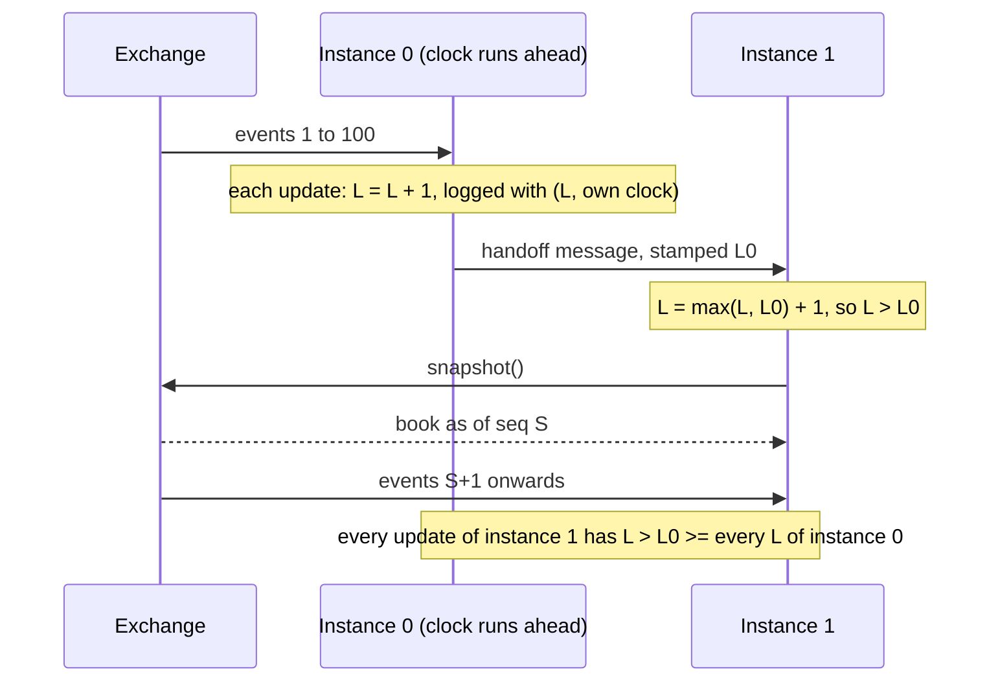

# gapless: a market data feed handler

Programming Assignment 1, Distributed Computing, IIIT Bangalore.

The assignment asks for a feed handler that:

1. **consumes a sequenced event stream**: the exchange numbers every event 1, 2, 3, ...;
2. **reconstructs the order book** from those events;
3. **detects and recovers from artificially injected gaps**: events lost, duplicated or reordered on the way;
4. and encourages **Lamport timestamps** once there are several independently clocked handler instances.

This project does all four in one small C++20 program (about 1,000 lines with tests), entirely in one process.
The "network" is a simulated lossy link, and recovery requests are function calls to the exchange.

## Build, test, run

Needs CMake 3.25+ and a C++20 compiler. GoogleTest is downloaded at configure time.

```bash
cmake -S . -B build -DCMAKE_BUILD_TYPE=Release
cmake --build build
ctest --test-dir build                 # 10 tests
./build/gapless_demo                   # every demo scenario; see "How to demo it"
```

## Directory structure

```
src/
  book/       order_book.hpp/.cpp     Event, Order, Level, OrderBook
  exchange/   exchange.hpp/.cpp       Exchange (event generator, truth book, history), Snapshot
  network/    lossy_link.hpp/.cpp     LossyLink, LinkConfig: loss, duplication, reordering, injected gaps
  handler/    feed_handler.hpp/.cpp   FeedHandler: gap detection and recovery, HandlerStats
  lamport/    lamport.hpp/.cpp        LamportClock, HandlerInstance, log merging, the handoff demo
apps/
  demo.cpp                            gapless_demo: the named demo scenarios
tests/
  order_book_test.cpp                 the book, event by event
  feed_handler_test.cpp               every recovery path, and 20 seeds of random damage
  lamport_test.cpp                    the clock rule, and ordering under clock skew
legacy/                               an earlier, much larger design; not built
```

## System architecture

The exchange generates the stream and is also the recovery service. Events
reach the handler through the lossy link; recovery bypasses the link, the way
a real handler would recover over a reliable TCP connection.



### Lamport extension

Two handler instances, each with its own physical clock and a Lamport clock,
take turns on the same stream. Instance 0 hands over to instance 1 with a
stamped message; each logs its book updates; the logs are merged afterwards.



## Class diagrams (UML)

### Feed handling



### Lamport extension



Free functions in `lamport/`: `merge_by_physical_time`, `merge_by_lamport_time`,
`count_order_violations` and `run_lamport_demo`.

## Sequence diagrams

### 1. A lost burst, recovered by retransmission (`gapless_demo burst`)



### 2. A reordered event and a duplicate, absorbed (`gapless_demo reorder`)



### 3. A gap older than the exchange's history: snapshot (`gapless_demo outage`)



### 4. Loss at the end of the stream: the heartbeat (`gapless_demo tail`)



### 5. Lamport timestamps across a handoff (`gapless_demo lamport`)



## How it works

- **Sequence numbers are the only clock that matters within a stream.** The handler applies events strictly in `seq` order, so its book is always the exchange's book as of some seq, never a mix.
- **Duplicates**: an event whose seq was already applied, or is already buffered, is dropped.
- **Gap detection**: an event beyond the next expected seq means something before it is missing. It is buffered.
- **Reordering vs loss**: a missing event is usually just late, so the handler waits 3 more arrivals (the reorder window). If the gap is still open, it is loss.
- **Recovery**: ask the exchange to retransmit the missing range. If the exchange no longer keeps it, take a snapshot of the whole book and continue after the snapshot's seq.
- **Tail loss**: when the stream goes quiet, the exchange's heartbeat reports its last seq; anything missing up to it is recovered the same way.
- **Lamport timestamps**: every update and message ticks the instance's Lamport clock, and receiving the handoff sets `L = max(L, L_msg) + 1`. So everything instance 0 did happens-before everything instance 1 does, and sorting by `(L, instance)` keeps the books' seq order whatever the physical clocks say. Sorting by physical time breaks once instance 0's clock leads by more than the handoff time.

## How to demo it

About five minutes. Build first (see above), then:

| Step | Command | What to point out |
| --- | --- | --- |
| 1 | `ctest --test-dir build` | 10 tests pass: the book, each recovery path, 20 random seeds, and the Lamport property |
| 2 | `./build/gapless_demo burst` | Seqs 11-15 are lost. 16 opens the gap, 17 and 18 wait in the buffer, and at 19 the handler gives up waiting and retransmits. The final book matches the exchange's |
| 3 | `./build/gapless_demo reorder` | Late events close gaps on their own and duplicates are dropped: **0 retransmissions**. This is why the handler waits a few arrivals before recovering |
| 4 | `./build/gapless_demo tail` | The last 3 events are lost and nothing after them arrives; only the heartbeat reveals the loss |
| 5 | `./build/gapless_demo outage` | 400 events lost, but the exchange keeps only 100: retransmission is impossible, so the handler takes a snapshot |
| 6 | `./build/gapless_demo random 1000000 20 7` | A million events at 20% loss, under a second: about 160,000 gaps recovered, and the book still matches exactly |
| 7 | `./build/gapless_demo lamport` | The table: physical time misorders updates once the clock skew passes the 5 ms handoff; Lamport time never does |

Questions to expect, and short answers:

- *Why not apply events as they arrive?* The book would be wrong after any reordering; applying strictly in seq order makes it always equal to the exchange's book at some seq.
- *Why wait 3 arrivals before recovering?* A reordered event is not lost. Recovering at once would retransmit every late event (step 3 shows they need none).
- *What if the retransmission itself is lost?* Recovery runs over a reliable channel (TCP in a real system; a function call here), so it is not.
- *Why Lamport and not physical timestamps?* Instances' clocks are not synchronised, and skew larger than the handoff time reorders updates (step 7). Lamport time respects happens-before, which here comes from the handoff message.
- *What does Lamport time not give you?* `L(a) < L(b)` does not mean `a` happened before `b`; it orders consistently with causality, nothing more.
